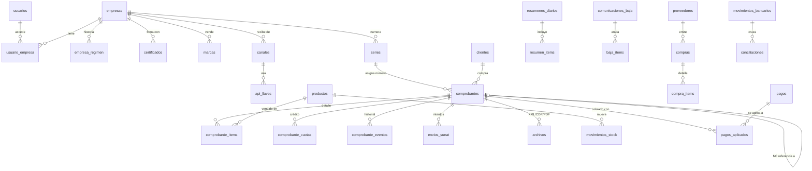

# Diseño de la base de datos (PostgreSQL)

> Estado: secciones A, B y C programadas en la fase 2 (`db/migraciones/`).
> Requiere PostgreSQL 15 o superior. *Row Level Security* se activa en la fase 6.
> Se diseña desde ya pensando en todos los módulos futuros, aunque estos se
> construyen después, uno por fase.

## Principios

1. **Multiempresa:** toda tabla de negocio tiene `empresa_id`. Además se activa
   *Row Level Security* (RLS) de PostgreSQL para que una empresa nunca vea datos
   de otra, aunque haya un error en el código.
2. **Dinero exacto:** montos en `NUMERIC(14,2)`; valores unitarios en
   `NUMERIC(22,10)`. Nunca `float`.
3. **Nada se borra:** comprobantes, compras, pagos y movimientos solo cambian de
   estado. El usuario de la aplicación no tiene permiso `DELETE` en esas tablas.
4. **Historial:** `creado_en`, `creado_por` en todas las tablas; eventos y
   auditoría aparte.
5. **Parámetros con vigencia:** tasas, UIT y límites viven en tablas con
   `vigente_desde` / `vigente_hasta`. Un comprobante usa el valor vigente en su
   fecha de emisión.
6. **Secretos cifrados:** certificados y credenciales SOL se guardan cifrados
   (AES-256-GCM) con una llave maestra que solo está en variables de entorno.
7. **Identificadores:** `uuid` en todas las tablas (no revelan cantidades).

## Mapa general

---

## A. Núcleo: usuarios, empresas y seguridad (fase 2)

### `usuarios`
| Columna | Tipo | Nota |
|---|---|---|
| id | uuid PK | |
| email | citext único | |
| nombre | text | |
| password_hash | text | Argon2id |
| totp_secreto_cifrado | bytea | verificación en dos pasos |
| totp_activo | boolean | obligatorio para roles dueño/admin |
| intentos_fallidos | int | límite de intentos |
| bloqueado_hasta | timestamptz | |
| activo | boolean | |

### `sesiones`
`id`, `usuario_id`, `empresa_activa_id`, `token_hash`, `ip`, `user_agent`,
`creado_en`, `expira_en`, `revocada_en`.

### `empresas`
| Columna | Tipo | Nota |
|---|---|---|
| id | uuid PK | |
| ruc | char(11) único | validado con dígito verificador |
| tipo_contribuyente | enum `PERSONA_JURIDICA` (RUC 20) / `PERSONA_NATURAL` (RUC 10) | |
| razon_social, nombre_comercial | text | |
| direccion_fiscal, ubigeo | text, char(6) | requerido en XML |
| codigo_establecimiento | char(4) | `0000` por defecto ⚠️ |
| logo_archivo_id | uuid | |
| ambiente_sunat | enum `BETA` / `PRODUCCION` | por defecto `BETA` |
| produccion_autorizada_por / _en | uuid / timestamptz | quién autorizó pasar a producción |
| indicadores_visibles | jsonb | qué ver en el dashboard |

### `empresa_regimen` (historial)
`empresa_id`, `regimen` (`NUEVO_RUS`, `RER`, `MYPE_TRIBUTARIO`, `GENERAL`),
`categoria_nrus`, `vigente_desde`, `vigente_hasta`.
El régimen vigente decide qué comprobantes se permiten y qué alertas se muestran.

### `credenciales_sol`
`empresa_id`, `ambiente`, `usuario_sol` (usuario **secundario**),
`clave_cifrada`, `actualizado_en`. Nunca la Clave SOL principal.

### `certificados`
`id`, `empresa_id`, `pfx_cifrado` (bytea), `clave_pfx_cifrada`,
`numero_serie`, `emisor`, `valido_desde`, `valido_hasta`, `activo`.
Alerta 30 días antes del vencimiento.

### `usuario_empresa`
`usuario_id`, `empresa_id`, `rol` (`DUENO`, `ADMIN`, `VENDEDOR`, `CONTADOR`,
`SOLO_LECTURA`). Un usuario puede tener varias empresas.

### `marcas`
`id`, `empresa_id`, `nombre` (ej. "Espacios y Diseño"), `logo_archivo_id`, `activa`.

### `canales`
`id`, `empresa_id`, `nombre` (tienda web, WhatsApp, Instagram, presencial, app taxi…),
`tipo` (`API`, `MANUAL`), `marca_id_por_defecto`, `activo`.

### `api_llaves`
`id`, `canal_id`, `prefijo` (visible, ej. `fk_live_ab12`), `hash` (SHA-256 de la llave),
`permisos` (jsonb), `ultimo_uso_en`, `revocada_en`, `revocada_por`.
La llave completa solo se muestra una vez al crearla.

### `auditoria`
`id`, `empresa_id`, `usuario_id` / `api_llave_id`, `accion`, `entidad`,
`entidad_id`, `antes` (jsonb), `despues` (jsonb), `motivo`, `ip`, `creado_en`.
Solo inserción (sin `UPDATE`/`DELETE`).

---

## B. Parámetros tributarios configurables (fase 2)

### `parametros_tributarios`
| Columna | Ejemplo |
|---|---|
| codigo | `IGV_TASA`, `UIT`, `BOLETA_MONTO_IDENTIFICAR`, `NRUS_LIMITE_ANUAL`, `NRUS_LIMITE_MENSUAL`, `RMT_PAGO_CUENTA_TASA`, `RMT_LIMITE_PAGO_CUENTA_UIT` |
| valor | `0.18`, `5500`, `700`, `96000`, `8000`, `0.01`, `300` |
| regimen | nulo = aplica a todos |
| vigente_desde / vigente_hasta | 2026-01-01 / nulo |
| fuente | "R.S. 303-2018 Anexo 2", enlace, fecha de consulta |

### `regimen_comprobantes_permitidos`
`regimen`, `tipo_comprobante`, `permitido`. Ej.: `NUEVO_RUS` + `01` (factura) = no.

### `exoneraciones`
`codigo`, `descripcion` (ej. "Transporte de pasajeros – Apéndice II num. 2"),
`tipo_afectacion_igv` (`20`), `vigente_hasta`, `fuente`. Al emitir se verifica
que siga vigente.

### Catálogos SUNAT
`cat_tipo_documento` (01, 03, 07, 08, RC, RA), `cat_tipo_doc_identidad`
(1 DNI, 6 RUC, 0, 4, 7…), `cat_afectacion_igv` (10, 20, 30…),
`cat_motivo_nota_credito` (catálogo 09), `cat_unidad_medida` (NIU, ZZ…),
`cat_ubigeo`. Se cargan desde los catálogos oficiales vigentes.

### `sunat_errores`
`codigo`, `mensaje_oficial`, `explicacion_es` (en palabras simples),
`que_corregir`, `tipo` (`RECHAZO`, `OBSERVACION`, `EXCEPCION`).

---

## C. Comprobantes (fases 2 a 6)

### `series`
| Columna | Nota |
|---|---|
| id, empresa_id | |
| tipo_comprobante | 01, 03, 07, 08 |
| serie | `F001`, `B001`, `FC01`, `BC01` (formato validado: empieza con F o B) |
| ultimo_numero | bigint, inicia en 0 |
| activa | |
| único | `(empresa_id, tipo_comprobante, serie)` |

**Cómo se numera sin saltos:** en una transacción:
`SELECT ultimo_numero FROM series WHERE id = … FOR UPDATE` → `+1` → `UPDATE` →
`INSERT` del comprobante → `COMMIT`. Si falla algo, se deshace todo.

### `clientes`
`id`, `empresa_id`, `tipo_doc_identidad`, `numero_doc`, `nombre_razon_social`,
`direccion`, `email`, `telefono`, `ruc_estado` / `ruc_condicion` (activo, habido),
`verificado_en`. Único `(empresa_id, tipo_doc_identidad, numero_doc)`.
Sirve también para el historial de compras.

### `productos`
`id`, `empresa_id`, `marca_id`, `sku`, `nombre`, `unidad_medida`,
`precio_con_igv`, `tipo_afectacion_igv`, `controla_stock`, `stock_minimo`,
`costo_promedio`, `activo`.

### `comprobantes`
| Columna | Nota |
|---|---|
| id, empresa_id | |
| serie_id, tipo_comprobante, serie, numero | único `(empresa_id, tipo_comprobante, serie, numero)` |
| fecha_emision, hora_emision | zona horaria Lima |
| moneda | `PEN` (USD a futuro) |
| cliente_id + copia de datos del cliente | la copia no cambia si el cliente se edita |
| marca_id, canal_id | origen |
| pedido_externo_id | id del pedido en la tienda |
| idempotencia_clave | único `(empresa_id, canal_id, pedido_externo_id)` sin contar los RECHAZADOS (migración 013) |
| forma_pago | `CONTADO` / `CREDITO` |
| total_gravado, total_exonerado, total_inafecto, total_igv, total_descuentos, importe_total | `NUMERIC(14,2)` |
| parametros_usados | jsonb: tasa IGV, UIT y límite vigentes al emitir |
| comprobante_referencia_id, motivo_nota_codigo, motivo_nota_texto | para notas de crédito/débito |
| estado | `BORRADOR`, `EMITIDO_LOCAL`, `PENDIENTE_ENVIO`, `ACEPTADO`, `ACEPTADO_OBS`, `RECHAZADO`, `ANULACION_EN_PROCESO`, `ANULADO` |
| ambiente_sunat | BETA / PRODUCCION (nunca se mezclan) |
| hash_firma | DigestValue, va en el PDF/QR |
| sunat_codigo_respuesta, sunat_mensaje | del CDR |
| estado_pago | `PENDIENTE`, `PARCIAL`, `PAGADO` (módulo de cobros) |
| emitido_por | usuario o llave API |

### `comprobante_items`
`id`, `comprobante_id`, `orden`, `producto_id`, `descripcion`, `unidad_medida`,
`cantidad NUMERIC(14,4)`, `precio_unitario_con_igv NUMERIC(22,10)`,
`valor_unitario_sin_igv NUMERIC(22,10)`, `tipo_afectacion_igv`,
`valor_venta NUMERIC(14,2)`, `igv NUMERIC(14,2)`, `total NUMERIC(14,2)`,
`costo_unitario` (para margen).

### `comprobante_cuotas` (ventas al crédito)
`comprobante_id`, `numero_cuota` (Cuota001…), `monto`, `fecha_vencimiento`, `pagada`.

### `comprobante_eventos`
`comprobante_id`, `estado_anterior`, `estado_nuevo`, `detalle`, `usuario_id`,
`motivo`, `creado_en`. Responde: quién, cuándo y por qué.

### `cola_envios`
| Columna | Nota |
|---|---|
| id, empresa_id | |
| tipo | `COMPROBANTE`, `RESUMEN_DIARIO`, `BAJA`, `CONSULTA_TICKET`, `CONSULTA_ESTADO` |
| referencia_id | |
| estado | `PENDIENTE`, `PROCESANDO`, `HECHO`, `FALLIDO_REVISAR` |
| intentos, proximo_intento_en | espera creciente |
| bloqueado_hasta | evita que dos trabajadores tomen el mismo trabajo (`FOR UPDATE SKIP LOCKED`) |
| ultimo_error | |
| fecha_limite_legal | para alertar antes de que venza el plazo |

### `envios_sunat` (cada intento)
`id`, `comprobante_id` / `resumen_id` / `baja_id`, `metodo` (`sendBill`,
`sendSummary`, `getStatus`), `ticket`, `http_estado`, `codigo_respuesta`,
`mensaje`, `duracion_ms`, `creado_en`.

### `archivos`
`id`, `empresa_id`, `entidad`, `entidad_id`, `tipo` (`XML`, `XML_FIRMADO`, `ZIP`,
`CDR`, `PDF`, `LOGO`, `EXTRACTO_BANCO`, `SUSTENTO`), `ruta_almacenamiento`,
`sha256`, `tamano`, `conservar_hasta` (mínimo +5 años), `creado_en`.
Los archivos van a almacenamiento tipo S3 con versionado; aquí solo la referencia.

### `resumenes_diarios` / `resumen_items`
Resumen: `empresa_id`, `identificador` (`RC-AAAAMMDD-n`), `fecha_referencia`,
`ticket`, `estado`. Item: `resumen_id`, `comprobante_id`, `condicion`
(1 adicionar, 2 modificar, 3 anular ⚠️).

### `comunicaciones_baja` / `baja_items`
Baja: `empresa_id`, `identificador` (`RA-AAAAMMDD-n`), `fecha_referencia`,
`ticket`, `estado`, `solicitado_por`. Item: `baja_id`, `comprobante_id`, `motivo`.

### `idempotencia_solicitudes`
`api_llave_id`, `clave`, `hash_cuerpo`, `respuesta` (jsonb), `creado_en`.
Si llega la misma clave con el mismo cuerpo → misma respuesta; con otro cuerpo → error.

---

## D. Módulos futuros (se diseñan ahora, se programan después)

### Descuento global (`010_descuento_global.sql`)
- `comprobantes.descuento_global` y `descuento_global_base`: descuento que rebaja la base imponible
  (catálogo 53, código 02), sin IGV, y la base gravada antes del descuento. `total_gravado` ya es el
  neto. Solo en facturas y boletas, e inmutable como el resto del comprobante.

### Inventario y compras — programado en la fase 8 (`009_inventario.sql`)
- `movimientos_stock`: `producto_id`, `tipo` (`VENTA`, `DEVOLUCION`, `COMPRA`, `AJUSTE`,
  `ANULACION`), `cantidad` (+ entra, − sale), `costo_unitario`, `comprobante_id` o `compra_id`,
  `motivo` (obligatorio en ajustes). **Solo se insertan**: el stock = suma de movimientos y una
  anulación agrega el movimiento contrario, nunca borra.
- `proveedores`: `ruc`, `razon_social`, y para el módulo de crédito fiscal `estado_sunat`,
  `condicion_sunat`, `verificado_en`.
- `compras`: `proveedor_id`, `tipo_comprobante`, `serie`, `numero`, `fecha_emision`, `periodo`
  (AAAA-MM), `base_imponible`, `igv`, `otros`, `total` (la base verifica que base + IGV + otros =
  total), `estado_validacion` (`PENDIENTE` hasta el módulo de crédito fiscal). Única por
  `(empresa, proveedor, tipo, serie, número)`. No se borra: se anula con motivo.
- `compra_items`: producto (opcional), cantidad, costo unitario sin IGV.
- `productos.costo_promedio`: promedio ponderado que actualizan las compras.
  `comprobante_items.costo_unitario` guarda el costo del momento de la venta (para el margen).
- `metas`: `tipo` (`MARGEN_SEMANAL`), `monto`, `vigente_desde` (las semanas pasadas conservan su meta).
- *Simplificación respecto al diseño inicial:* un solo almacén por ahora (sin tabla `almacenes`);
  los productos dañados se registran como `AJUSTE` con su motivo. Los campos de crédito fiscal
  (`da_credito_fiscal`, `bancarizado`) llegan con ese módulo.

### Cobros y seguimiento — programado en la fase 7 (`008_cobros.sql`)
- `pagos`: `comprobante_id`, `fecha`, `monto`, `medio` (`YAPE`, `PLIN`, `EFECTIVO`,
  `TRANSFERENCIA`, `TARJETA`, `PASARELA`, `OTRO`), `referencia_operacion` (única por medio:
  el mismo Yape no se registra dos veces), anulación con motivo (no se borra ni se edita).
  *Simplificación respecto al diseño inicial:* cada pago va a un solo comprobante, así que la
  tabla intermedia `pagos_aplicados` no hizo falta.
- `comprobante_cuotas.monto_pagado`: hasta dónde cubren los pagos cada cuota (en orden de vencimiento).
- `comprobantes.estado_pago` se recalcula desde los pagos y las notas de crédito vigentes.
- Pendiente: consulta automática del estado en SUNAT (`billConsultService`, requiere el usuario SOL
  de producción). Hoy los rechazos se detectan y avisan al momento del envío.

### Devoluciones — programado (`012_devoluciones.sql`)
- `devoluciones`: `comprobante_origen_id`, `nota_credito_id` (única), `tipo` (`TOTAL`, `PARCIAL`),
  `motivo`, quién y cuándo.
- `devolucion_items`: `item_orden` (línea del comprobante), `cantidad`, `destino` (`REINGRESO`, `DANADO`).
- `reembolsos`: `devolucion_id`, `monto`, `medio` (los mismos de `pagos`), `referencia`, `fecha`.
- Las tres son solo inserción. Lo ya devuelto se cuenta solo con notas de crédito vigentes
  (si SUNAT rechaza una, esas unidades se pueden volver a devolver).

### Crédito fiscal y SIRE
- `sire_propuestas`: `periodo`, `archivo_id`, `importado_en`.
- `sire_propuesta_items`: datos de cada factura que SUNAT dice que recibiste,
  `compra_id` (si se cruzó), `resultado_cruce` (`COINCIDE`, `NO_REGISTRADA`,
  `NO_RECONOCIDA`).
- `credito_fiscal_mensual`: `periodo`, `igv_compras_valido`, `saldo_anterior`,
  `saldo_a_favor_siguiente`, `credito_perdido_sin_factura` (estimado).

### Finanzas e impuestos (siempre "estimados")
- `gastos_fijos`: `concepto`, `monto_mensual`, `vigente_desde`.
- `estimaciones_impuestos`: `periodo`, `igv_ventas`, `igv_compras`, `igv_nc`,
  `igv_a_pagar`, `pago_a_cuenta_renta`, `reserva_sugerida`, `calculado_en`,
  `parametros_usados` (jsonb).
- `cronograma_vencimientos`: `periodo`, `ultimo_digito_ruc`, `fecha_vencimiento`,
  `fuente` (se carga cada año desde el cronograma oficial de SUNAT).

### Conciliación bancaria
- `cuentas_bancarias`: `banco`, `numero_cifrado`, `moneda`.
- `movimientos_bancarios`: `cuenta_id`, `fecha`, `descripcion`, `monto`,
  `referencia`, `origen` (`EXCEL`, `CSV`, `PASARELA`, `API_BANCO` a futuro),
  `hash_linea` (evita importar dos veces la misma línea).
- `pasarela_eventos`: `proveedor` (Culqi, Izipay, Niubiz, Mercado Pago),
  `evento_id` único, `payload` (jsonb), `firma_valida`, `procesado`.
- `conciliaciones`: `movimiento_bancario_id`, `pago_id` / `comprobante_id`,
  `tipo` (`VENTA`, `APORTE_CAPITAL`, `PRESTAMO`, `REEMBOLSO`, `OTRO`),
  `sustento_archivo_id`, `alerta_sin_comprobante`.

### Perfil taxista (RUC 10)
- `vehiculos`: `placa`, `soat_vence`, `revision_tecnica_vence`,
  `proximo_mantenimiento_km` / `_fecha`.
- `carreras`: `fecha_hora`, `monto`, `canal` (`APP`, `CALLE`), `app_nombre`,
  `medio_pago`, `comprobante_id` (boleta exonerada, opcional).
- `gastos`: tabla genérica para todas las empresas: `categoria` (gasolina,
  alquiler, mantenimiento…), `monto`, `fecha`, `compra_id` si tiene factura.
- `recordatorios`: `tipo`, `fecha`, `vehiculo_id`, `enviado`.

### Dashboard y alertas
- `alertas`: `empresa_id`, `tipo`, `severidad` (`VERDE`, `AMARILLO`, `ROJO`),
  `mensaje`, `entidad`, `entidad_id`, `vista_en`, `resuelta_en`.
- Los indicadores se calculan con vistas (`VIEW`) sobre las tablas anteriores.

### Venta a otros negocios (a futuro)
- `planes`, `suscripciones`: preparado, pero sin programar. La estructura
  multiempresa ya lo permite.

---

## E. Seguridad en la base de datos

- Dos usuarios de base de datos: `app` (sin `DELETE` en tablas de documentos) y
  `migraciones` (solo para cambiar estructura).
- RLS por `empresa_id` en todas las tablas de negocio.
- Columnas `*_cifrado` con AES-256-GCM; la llave maestra solo en variable de entorno.
- Bases de datos separadas para pruebas y producción.
- Respaldo diario automático + prueba de restauración mensual.
